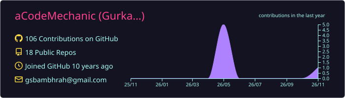
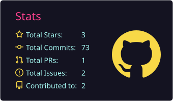
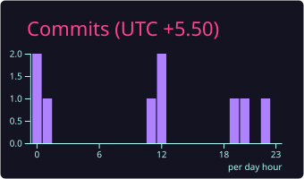
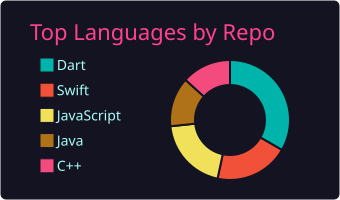
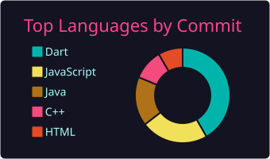

# Hi, I'm Gurkaranvir Singh Bambhrah 👋

> 🟢 **Open to work** — Mobile Lead / Flutter Lead roles · Noida / NCR or remote · available from **1 Dec 2026**

---

## 🧑‍💻 About me

I'm a **Mobile Tech Lead** with **11+ years** of building high-performance Android and iOS apps — natively and cross-platform — plus the web and backend pieces around them. I pick the right approach for each product and own delivery end to end, from requirements to release.

- 🔭 Currently **Lead Developer at [GenAquarius](https://www.genaquarius.com/)**, leading a team of 6 across mobile, web and backend for healthcare and AI products
- 🔁 Led migrations of native and Ionic apps to **Flutter** (Foundry BC, Abhyaasa)
- 📈 Worked on apps with **10M+**, **1M+** and **500K+** downloads
- 🛡️ Keep crash/ANR rates at **≤ 0.01%** through testing, profiling and code reviews
- ⚡ Brought production APIs under **200 ms** with query tuning, indexing and Redis caching
- 🧭 Mentor developers, run code reviews, and move teams to 2-week sprints with regular client demos

## 🛠️ Tech stack

**Mobile**

**Web & Backend**

**Data, Cloud & DevOps**

<b>More detail</b>

| Area | Tools |
|---|---|
| Android | Kotlin, Java, Jetpack Compose, MVVM, Coroutines, Flow, Room, Hilt, Retrofit |
| iOS | Swift, Objective-C, SwiftUI, UIKit, Combine, Core Data, CocoaPods, SPM |
| Cross-platform | Flutter, Dart, Bloc, Riverpod, Provider, GetX, Platform Channels, Ionic |
| Architecture | Clean Architecture, MVVM, VIPER, Microservices, Offline-first, HL7 integration |
| Testing | Unit, Widget, Integration & Golden tests, JUnit, XCTest, Jest |
| Release | GitHub Actions, Codemagic, Fastlane, Play Console, App Store Connect |

## 📱 Featured work

| App | What it is | Stack | Reach |
|---|---|---|---|
| **StepSetGo** | Step-tracking rewards app | Kotlin, Swift, React | 10M+ downloads |
| **Elyments** | Chat, audio & video calling (Android, iOS, web) | Kotlin, Swift, React | 1M+ downloads |
| **Abhyaasa** | Meditation & wellness, rebuilt from Ionic to Flutter | Flutter | 500K+ downloads |
| **Mega Cabs** | Airport rides — rider, driver & staff apps | Kotlin, Swift | 100K+ downloads |
| **Novade** | Construction field management with offline mode | Flutter | 100K+ downloads |
| **Foundry BC** | In-person & virtual mental-health care for young people | Kotlin, Swift, Flutter, React | 45K+ users |

These are client projects built during my roles; see the <a href="https://acodemechanic.github.io/">portfolio</a> for more.

## 📊 GitHub stats

<!-- Cards below are generated by .github/workflows/profile-summary-cards.yml and committed to this repo -->

  

  
  

  
  

  

<b>Note:</b> most of my work lives in private company repos, so these stats only reflect public code — not experience or skill level.

---

  <b>Let's build something.</b> Reach me on <a href="https://www.linkedin.com/in/gurkaranvir-singh-bambhrah/">LinkedIn</a> or by <a href="mailto:gurkaran.bambhrah@gmail.com">email</a>.

